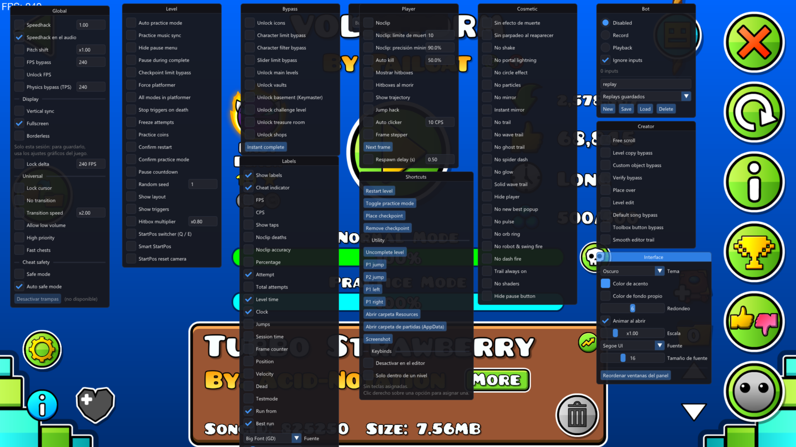
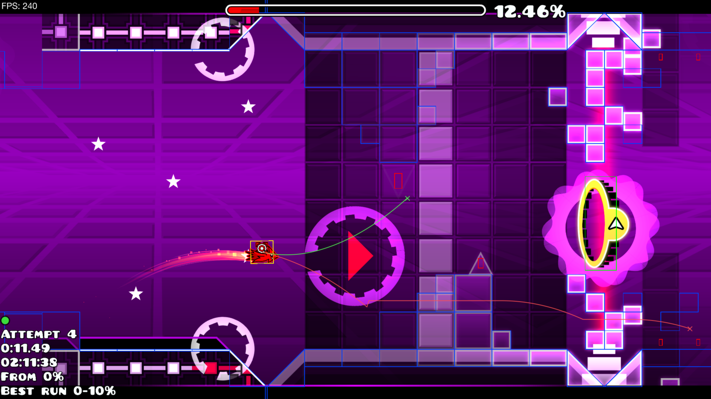
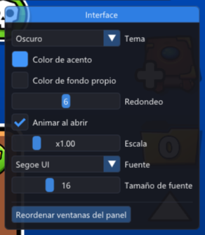

<div align="center">

# GD Mod Menu

**Panel de mods para Geometry Dash (Steam, Windows), al estilo Mega Hack y sin Geode.**

Para practicar niveles, ver hitboxes y trayectorias, grabar replays y trabajar más cómodo en el editor.

[](https://github.com/johanncortes/gd-mod-menu/releases/latest)


</div>

<!-- CAPTURAS: guarda las imágenes en docs/img/ con estos nombres y quita este comentario.
<div align="center">
  
  <br><br>
  
  
</div>
-->

## Instalación

1. Descarga **`GDModMenu.exe`** desde [la última versión](https://github.com/johanncortes/gd-mod-menu/releases/latest).
2. Ábrelo. Si Geometry Dash no está abierto, lo abre por Steam y espera a que cargue.
3. Cuando salga el aviso de "Listo", pulsa **Tab** dentro del juego.

No hay que instalar nada más ni copiar archivos a la carpeta del juego. Hay que abrir `GDModMenu.exe`
cada vez que abras el juego.

> **Antivirus:** el programa carga una DLL dentro del juego, y algunos antivirus avisan de cualquier
> programa que haga eso. Si lo bloquea, añade una excepción o compílalo tú mismo (ver [Compilar](#compilar)).

## Qué incluye

Más de 100 opciones repartidas en ventanas. Con **Search** se busca cualquiera por nombre.

| Ventana | Opciones |
| --- | --- |
| **Global** | Speedhack (con audio), pitch shift, FPS bypass, unlock FPS, physics bypass (TPS), lock delta, VSync, fullscreen, borderless, lock cursor, no transition, transition speed, allow low volume, high priority, fast chests, safe mode y auto safe mode |
| **Player** | Noclip (con contador, precisión y límites), auto kill, mostrar hitboxes (también al morir), show trajectory, jump hack, auto clicker, frame stepper, respawn delay |
| **Level** | StartPos switcher, smart StartPos, auto practice, practice music sync, practice coins, checkpoint limit bypass, show layout, show triggers, hitbox multiplier, random seed, stop triggers on death, force platformer, all modes in platformer, freeze attempts, hide pause menu, pause during complete, pause countdown, confirmar reinicio y cambio de modo |
| **Cosmetic** | Sin efecto de muerte, no shake, no particles, no mirror, instant mirror, no glow, no pulse, no shaders, no trail, trail always on, no wave trail, solid wave trail, no ghost trail, no spider dash, no robot / swing / dash fire, no orb ring, no circle effect, no portal lightning, no new best popup, hide player, hide pause button |
| **Bypass** | Unlock icons, main levels, vaults, shops, treasure room, challenge y basement; character limit y filter, slider limit, instant complete |
| **Creator** | Free scroll, level copy, level edit, custom object bypass, place over, default song bypass, toolbox button bypass, smooth editor trail, verify bypass |
| **Labels** | FPS, CPS, show taps, porcentaje, intentos (del nivel y totales), tiempo, reloj, saltos, frames, posición, velocidad, best run, run from, testmode, noclip y cheat indicator |
| **Bot** | Grabar y reproducir inputs, guardar y cargar replays |
| **Shortcuts** | Reiniciar, modo práctica, checkpoints, saltos de P1 y P2, screenshot, uncomplete level, abrir carpetas |
| **Interface** | Tema, colores, redondeo, escala, fuente y animación del panel |

El **cheat indicator** se pone en rojo cuando hay alguna trampa activa, y con *Auto safe mode* (activado
por defecto) esos intentos no guardan progreso.

## Uso

- **Tab** abre y cierra el panel.
- **Clic derecho** sobre una casilla o un botón le asigna una tecla (Supr la quita).
- Los campos numéricos se aplican al pulsar **Enter** o al salir del campo.
- Los **labels** se arrastran con el ratón dentro de un nivel, con el panel abierto.
- Si una opción aparece como "(no disponible)", esa función no se encontró en tu versión del juego: el
  resto sigue funcionando.

## Preguntas frecuentes

**¿Con qué versión de Geometry Dash funciona?**
Con la de Steam, versión 2.2091. Si el juego se actualiza, las opciones que dejen de encajar se
desactivan solas en vez de romper el juego.

**¿Dónde se guarda mi configuración?**
En `%LOCALAPPDATA%\GDModMenu\config.json`. Ahí están también la DLL y el registro (`gdmenu.log`).

**¿Cómo lo desinstalo?**
Borra `GDModMenu.exe` y la carpeta `%LOCALAPPDATA%\GDModMenu`. No modifica los archivos del juego.

**¿Necesito Geode?**
No. Es una DLL independiente.

**¿Me pueden banear?**
El panel no sube completions ni habla con los servidores del juego, y el safe mode evita que los intentos
con trampas guarden progreso. Aun así, úsalo bajo tu responsabilidad y no para récords ni listas.

## Compilar

Hace falta [Visual Studio 2022 Build Tools](https://visualstudio.microsoft.com/es/downloads/) (carga
"Desarrollo para el escritorio con C++"), [CMake](https://cmake.org/download/) 3.24 o más nuevo y
[Git](https://git-scm.com/download/win). MinHook, Dear ImGui y nlohmann/json se descargan solos.

```
git clone https://github.com/johanncortes/gd-mod-menu.git
cd gd-mod-menu
cmake -B build -A x64
cmake --build build --config Release
```

En `build/Release/` quedan:

| Archivo | Qué es |
| --- | --- |
| `GDModMenu.exe` | El lanzador de un solo archivo (lleva la DLL dentro) |
| `gdmenu.dll` | La DLL del panel |
| `injector.exe` | Inyector de desarrollo: carga la `gdmenu.dll` que tiene al lado en el juego ya abierto |
| `sigcheck.exe` | Comprueba las firmas contra un `GeometryDash.exe` sin abrir el juego |

| Opción de CMake | Por defecto | Qué hace |
| --- | --- | --- |
| `GDMENU_DEV` | `ON` | La tecla End descarga la DLL, para recompilar e inyectar sin cerrar el juego. Las versiones publicadas se compilan con `OFF` |
| `GDMENU_CONSOLE` | `OFF` | Abre una consola de debug al cargar la DLL (le quita el foco al juego) |

## Si GD se actualiza

Las funciones del juego se localizan con firmas de bytes, no con direcciones fijas. Para ver qué firmas
fallan tras una actualización, sin abrir el juego:

```
build\Release\sigcheck.exe "C:\Program Files (x86)\Steam\steamapps\common\Geometry Dash\GeometryDash.exe"
```

Las firmas están en [src/core/signatures.hpp](src/core/signatures.hpp) y documentadas en
[docs/firmas.md](docs/firmas.md). El plan y el estado del proyecto están en [PLAN.md](PLAN.md).

---

<div align="center">
Proyecto no oficial, sin relación con RobTop Games. Geometry Dash es una marca de RobTop Games.
</div>
